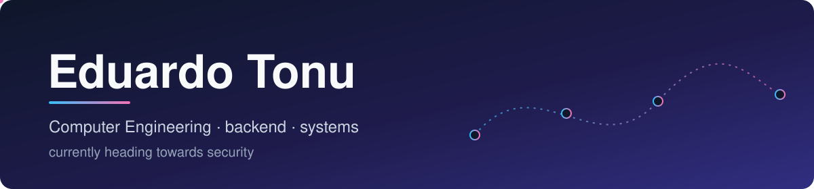

  

  <b>🇬🇧 English</b> &nbsp;·&nbsp; <a href="README.pt.md">🇵🇹 Português</a>

## Hi, I'm Eduardo 👋

I'm curious about what happens **between the click and the packet**.

I'm a third-year Computer Engineering student who writes Java for fun, builds Minecraft mods that do more than they probably should, and is steadily pointing his career at **cybersecurity**. I learn by building things, breaking them, and then building them again with fewer bugs (the bugs are never fewer, but the intention is there).

<!-- LOOKING FOR: update this line whenever it changes -->
> 🟢 **Open to projects** · interested in backend, systems, games and security.

---

## 🧭 Right now

| | |
|---|---|
| 🛠️ **Building** | A computer-networks project for uni, my first real step into the network side of security |
| 📚 **Learning** | C, OpenGL, and more JavaScript than I planned |
| 🎓 **Finishing** | Third year of the degree, with a Minecraft automation mod as my latest side project |

---

## 🧪 Things I've built

| Project | What it does |
|---|---|
| **Market analyzer** | A JavaScript Minecraft mod plus a Python program that read the Hypixel market, work out the best trades, and send them back to the mod. Two languages, one very opinionated spreadsheet. |
| **Farming mod** | A Minecraft mod that farms and clears pests on its own. Built to see how far a well-structured automation loop can go. |
| **Support & resistance indicator** | A Pine Script for TradingView that finds the support and resistance zones that actually matter and draws them on the chart. |
| **Networks project** | Computer networks coursework in progress. The one pushing me towards low-level thinking. |
| **Online shop website** | Designed, built and shipped for a real customer (me). The most demanding client I've had. |
| **Discord bots** | A few of them, because every programmer has a phase. |

> Most of these live in private repos for now. I'm cleaning them up and publishing them one by one.

---

## 🧰 Toolbox

How well I actually know things, no inflation:

**I work with**

**I know my way around**

**Workflow**

Prolog is on this list in spirit: we coexist peacefully, but I wouldn't say we understand each other.

---

## 🎯 Where I'm headed

Cybersecurity is the direction I want to take, and I'm being honest about the starting line: no professional experience in it yet, just the right foundations being laid.

- **Networks and C** are the bridge, because you can't secure what you don't understand
- **Databases, automata and programming languages** at uni give me the theory behind how systems break
- **Building tools and automation** has taught me to think about how things get misused, not just how they work

---

## 🛠️ How I work

- I build the small working version first, and make it nice afterwards
- I use Claude Code as a pair programmer, and I want to understand every line that lands in my code
- I'd rather ship a messy thing that works than a perfect thing that doesn't exist

---

## 📡 Recent activity

<!--ACTIVITY:START-->
- Fresh repos coming soon.
<!--ACTIVITY:END-->

This section refreshes itself daily with my most recently updated public repositories.

---

## 🏍️ Off the keyboard

- **Motorbikes**: the only place I don't want a stack trace
- **Financial markets**: I trade futures and write my own tools for reading charts
- **Games**: as a player first, and now also as a developer

---

## 🤝 Say hi

<!-- ADD WHEN READY: LinkedIn / email / portfolio. Example:

-->

The best way to reach me for now is through an issue or discussion on any of my public repos.

Computer Engineering student at NOVA FCT 🇵🇹

